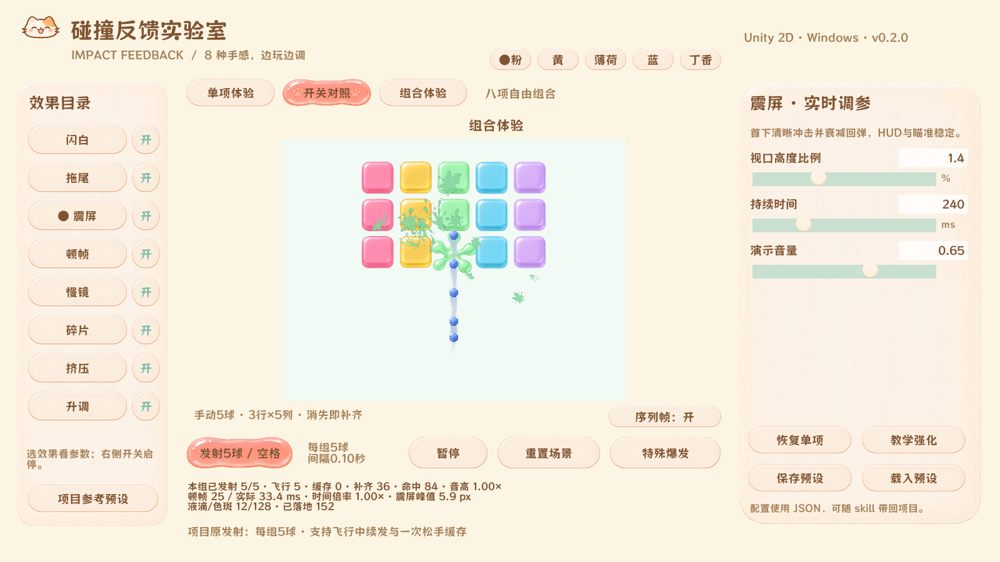

# Unity 2D 碰撞反馈

供 Codex 使用的 skill，包含闪白、拖尾、震屏、顿帧、慢镜、碎片、挤压和升调，以及使用 BounceBusters 素材的独立 Windows 调参展馆。

展馆提供单项、开关对照和组合模式；支持滑条／数值框、预设保存载入、手动五球发射、3×5棋盘与消失即补齐。顿帧／慢镜通过两个独立的真实2D物理场景演示。

0.2.2：同步游戏 0.5.1 的多色花瓣破砖效果：从击碎点飘出、翻转、随机落地，停留后淡出。共用 128 槽池，碎片页支持切换旧颜料，旧 JSON 预设保持兼容。素材、参数及接入方法见 [花瓣说明](references/petals.md)。

0.2.2 验证：Unity 6000.0.26f1 / Windows x64 构建 0 错误、0 警告；30fps、60fps 各 148 项通过，原发射 13 项源码／资源比对通过。24 项资源齐全，22 个已有哈希全部匹配；[验证记录](references/petal-validation.json)。其他平台与渲染管线尚未验证。

使用项目正式的粉、黄、薄荷绿、蓝、丁香紫五色方砖，可切换颜色；复用各色16帧／25fps破碎序列，可单独开关。



- Skill 入口：[SKILL.md](SKILL.md)
- 参数：[八种效果](references/effects.md)
- 使用、构建与打包：[展馆说明](references/gallery.md)
- 源码：`assets/unity-sample`，Unity **6000.0.26f1 / Built-in / Windows x64**
- 展示包与带展示包的完整 skill ZIP：**Releases**；源码也可在本地构建。

```powershell
./scripts/build.ps1
./scripts/verify.ps1 -Fps 60
./scripts/verify.ps1 -Fps 30
python ./scripts/package.py
python ./scripts/install.py --with-windows
```

素材来源、适配差异和授权说明见 [来源映射](references/project-source-map.md)。本次花瓣按项目所有者要求同步至指定仓库，其他项目素材继续遵循各自来源与许可说明。


0.2.0：取消自动发射；玩家拖动瞄准、松手发射一组5球（间隔0.10秒）；15格五色方砖播完破碎序列立即补齐。震屏增加首下冲击，拖尾复用原线芯Shader，碎片恢复为液滴落成原版颜料色斑。验证结果与哈希随Release附带。

发射输入与排队直接复用原GameSession／ChainLiveSession／AppUI／RuleState；包括12°–168°方向约束、炮口偏移、整组预留、固定步出球、0.55秒连发及一次松手缓存。展馆仅做坐标与物理对象绑定。可执行 `python scripts/verify_project_launch.py` 核对来源。

0.2.1：升调改为do re mi fa so la xi 高音do，使用固定音高短促乐音。密集事件不跳音、断连回do、最高级封顶；可调音符间隔／音量／最高音阶，并显示当前音符。原项目发射代码保持不变。

0.2.1验证：30fps和60fps配置各131项通过，原20条RuleState规则自测通过；包括实际PCM音高、八级推进、密集碰撞不跳音、断连重置和旧预设兼容。音阶试听文件随发布包附带。
