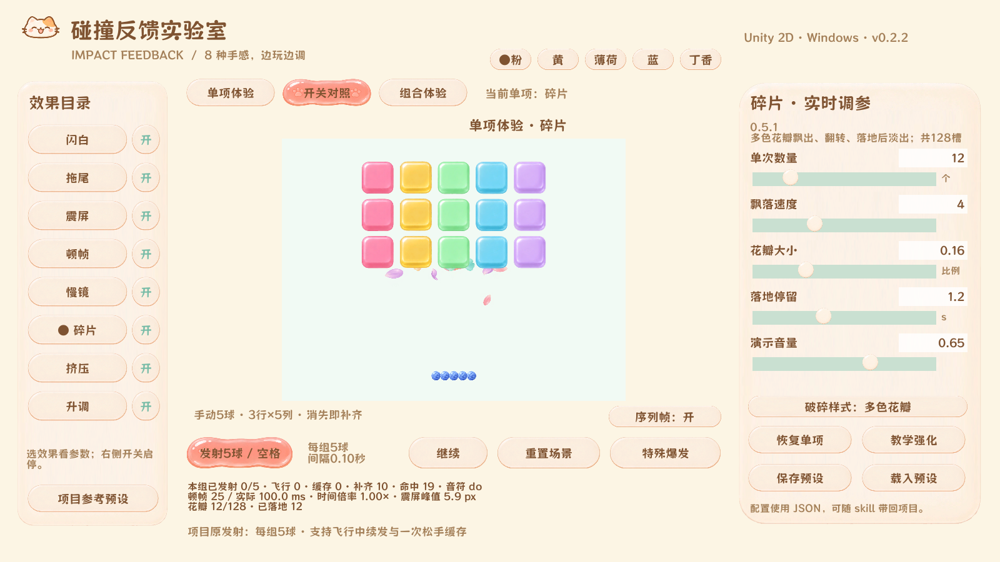

# 0.5.1 砖块花瓣反馈

展馆 0.2.2 同步 BounceBusters 0.5.1 的原始花瓣图集与运动公式。每次破砖默认从命中点发出 12 片花瓣，在 0.85–1.5 秒内沿弧线飘向随机落点，伴随横向摆动、旋转和翻面；落地停留后用 0.55 秒淡出。四种颜色、四种轮廓共 16 帧，使用白色顶点颜色保留原图颜色，不乘砖块颜色。



## 迁移

复制 `Assets/ImpactFeedback/Runtime` 及 `Assets/Resources/ImpactFeedback/break-petals-atlas.png`（包括 `.meta`）。`PetalAtlas` 在初始化时缓存切出的 16 张 Sprite，多个 Presenter 共享；每次击碎不创建 Sprite、材质或 GameObject。现有 `Initialize` 调用签名保持兼容，旧颜料模式仍需原有 `particleSprites` 数组。

```csharp
presenter.Profile.petalFragments = true;
presenter.PetalLandingBounds = new Rect(left, bottom, width, height); // 世界坐标，可不设置
presenter.PetalAirSortingOrder = 78;
presenter.PetalGroundSortingOrder = 20; // 根据宿主的砖块、背景层设置
presenter.Hit(contactPoint, incomingDirection, brickTint,
              ImpactKind.Break, brickVisual, brickWidth);
```

`fragmentCount` 控制数量；`fragmentSpeed=4` 对应原始飞行速度；`fragmentSize=.16` 对应原始大小；`fragmentLife=1.2` 控制落地停留基值（最低 .8 秒，另加 .15–.65 秒随机停留）。总寿命包含飞行、停留和淡出。`paintMinRadius/paintMaxRadius` 保留为兼容的散布半径参数，花瓣模式限制到源码的 .3–1 / 最大 2.8 砖宽范围。

共用原 128 槽池，超额丢弃，不增设物理碰撞体；随机使用独立 `System.Random`。`Step` 的表现 delta 为 0 时冻结，`ResetPresentation`、失焦、禁用或关闭碎片时清理。`ActiveLandedPetals` 统计落地花瓣，`ActivePaintMarks` 专用于旧颜料；`ActiveParticles` 和 `LandedParticles` 覆盖两种模式。

展馆使用普通世界坐标，因此移除了源游戏的 `BoardDisplay` 非线性投影；落点范围由宿主提供，不硬编码源游戏棋盘边界。展馆落地层级为 20，源游戏为 -22。接入源项目时保留源项目自己的投影和排序策略。

## 兼容与来源

新建参数默认花瓣；通过 `ImpactProfile.FromJson` 加载缺少 `petalFragments` 的旧 JSON 时保持旧颜料。展馆碎片参数下可切换两种模式；恢复碎片单项会恢复花瓣默认值。

使用 `python scripts/import_project_petals.py --source D:/Game/BounceBusters` 独立导入，不要求新项目保留已经删除的旧版颜料文件。原始生成提示、SHA-256、原代码哈希及适配差异见 [petal-source.json](petal-source.json)，素材总表见 [asset-manifest.json](asset-manifest.json)。原始 PNG SHA-256 为 `2d8126aa8be22bbb8574d891b85c3caa8b7e331302bde2375aa534575b44d537`。

该图集由项目内置 image_gen 原创生成，无第三方参考图输入。本次按项目所有者要求同步至指定 GitHub 仓库；不因此变更仓库内其他已有素材的许可。
